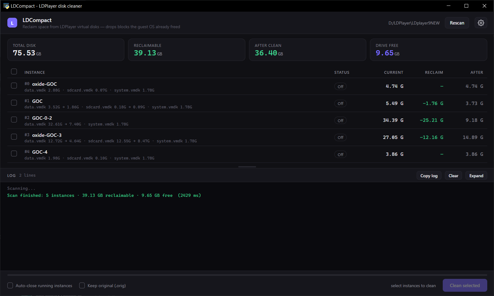

# LDCompact

**Reclaim the disk space LDPlayer never gives back.**

[English](#english) · [Tiếng Việt](#tiếng-việt)



---

## English

### The problem

LDPlayer stores each emulator instance on a sparse VMDK image. When you uninstall an app, clear cache, or delete files inside Android, the guest ext4 filesystem marks those blocks as free — but the VMDK on your SSD never shrinks.

LDPlayer has **no TRIM/discard support** and `ldconsole.exe` has **no compact command**. The result is predictable: an instance whose `/data` partition holds 7 GB of real data can occupy 32 GB of your drive. Uninstalling things makes it worse over time, never better.

### What this tool does

LDCompact reads the virtual disk at the format level — VMDK grain tables *and* the ext4 block bitmaps inside — then rebuilds the image keeping only the grains that actually contain live data.

The output is a **physically smaller file**, not just a sparse one. Both the size on disk and the size Windows Explorer reports go down.

### How it works

A sparse VMDK is laid out as:

```
[ header 512B ][ descriptor ][ redundant GD ][ RGD tables ][ GD ][ GT tables ][ pad ][ grain data ... ]
```

* **Grain size** is 64 KB = **16 ext4 blocks** of 4 KB.
* For each grain, LDCompact checks whether all 16 corresponding blocks are marked free in the ext4 block bitmap.
* Fully-free grains are dropped. Partially-used grains are kept whole.
* The new image copies the header, descriptor, RGD and GD **byte-for-byte at the same offsets** — only the grain table entries change.
* Grain tables and their redundant mirrors (`GT` / `RGT`) are written identically, because VirtualBox cross-checks them and refuses to open the disk on mismatch.
* Every kept grain is compared byte-for-byte after writing, the new image is structurally validated, and only then does it replace the original.

### Safety guards

Nothing is written until every check passes. The log records each one.

| # | Check | On failure |
|---|-------|------------|
| 1 | Instance directory exists | skip |
| 2 | Instance is stopped (or `ldconsole quit` succeeds within 90 s) | skip |
| 3 | `.vmdk` exists and is readable | abort |
| 4 | Header valid: version 1, `compressAlgorithm=0`, grain power-of-two ≥ 8, `numGTEsPerGT` 128–512, overhead ≤ file size | abort |
| 5 | **ext4 `state == 1`** (cleanly unmounted) | abort with instructions |
| 6 | At least one reclaimable grain | skip (not an error) |
| 7 | Free space ≥ projected size + 256 MB | abort |
| 8 | No leftover `.new` / `.orig` from a previous run | abort |

After writing: structural validation (GT mirrors RGT, no grain points outside the file, file size matches grain count) and automatic rollback if the file swap fails.

The tool has been verified end-to-end: a compacted 3.5 GB → 1.9 GB image boots normally and `e2fsck -n` reports **`clean, 5053/1646592 files, 568202/6569984 blocks`**.

### Why "clean up" and not "delete junk"?

Because **nothing is deleted**. The operation does not remove a single byte of your apps, accounts or files — it only stops copying blocks the guest OS already declared free. Technically it is *compaction*, not cleaning.

The UI labels the action **Clean up** because that is what it feels like, but the app is named LDCompact for a reason: if you want to understand what it does, it compacts.

### Requirements

* Windows 10/11
* Python 3.9+
* LDPlayer 9 (VirtualBox-backed VMDK images)
* `pip install pywebview`

### Usage

```bat
git clone https://github.com/HunterOct/ldcompact.git
cd ldcompact
pip install pywebview
run.bat
```

1. The tool auto-detects your LDPlayer installation (registry + drive scan).
2. Press **Rescan** — every instance is analysed in parallel.
3. Tick the instances you want, press **Clean up**.
4. Enable **Auto-close running instances** if any of them is running.
5. Enable **Keep original (.orig)** if you want a rollback copy (costs disk space).

### Performance

Measured on an Intel NVMe SSD, 5 instances / 75 GB of virtual disks:

| | Before | After |
|---|---|---|
| Full scan (cold) | 24 s | **2.4 s** |
| Full scan (cached) | — | **0.2 s** |
| Analysis of one 32 GB image | 3.0 s | **0.27 s** |

Two changes made the difference: reading grain tables as contiguous runs instead of 8192 individual seeks, and testing 16 bitmap bits per grain with `int.bit_count()` instead of a per-bit Python loop. Results are cached by `(path, size, mtime)`.

### Interface

* Dark / Light / Auto theme and English / Vietnamese UI, saved to `config.json`.
* Live log with timestamps, colour-coded severity, resizable panel, copy-to-clipboard.
* Per-instance breakdown of `data.vmdk` and `sdcard.vmdk`.

### Limitations

* `system.vmdk` is never touched — it is a read-only system image with nothing to reclaim.
* The instance must be shut down; a running guest can hold filesystem state that is not yet on disk.
* Compaction rewrites the image, so it writes roughly the size of the retained data once. That is unavoidable if you want a smaller file.
* Tested against LDPlayer 9.5.x images. Other sparse VMDK producers may use different grain sizes; the guards reject anything unexpected.

### License

MIT — see [LICENSE](LICENSE).

---

## Tiếng Việt

### Vấn đề

LDPlayer lưu mỗi máy ảo trong một file VMDK dạng sparse. Khi bạn gỡ app, xoá cache hay xoá file bên trong Android, ext4 đánh dấu các block đó là free — nhưng file VMDK trên ổ SSD **không bao giờ nhỏ lại**.

LDPlayer **không hỗ trợ TRIM/discard**, và `ldconsole.exe` **không có lệnh compact**. Kết quả rất dễ đoán: một máy ảo chỉ dùng 7 GB dữ liệu thật trong phân vùng `/data` 47 GB vẫn có thể chiếm 32 GB trên ổ của bạn. Càng gỡ app, nó càng phình chứ không nhỏ đi.

### Tool này làm gì

LDCompact đọc đĩa ảo ở tầng định dạng — bảng grain của VMDK **và** block bitmap của ext4 bên trong — rồi dựng lại file chỉ giữ những grain thực sự còn dữ liệu.

Kết quả là file **nhỏ đi thật**, không phải chỉ giảm dung lượng chiếm chỗ. Cả dung lượng trên đĩa lẫn con số Windows Explorer hiển thị đều giảm.

### Cơ chế

* Một **grain** = 64 KB = **16 block ext4** (4 KB).
* Grain chỉ bị bỏ khi **cả 16 block** đều được đánh dấu free trong block bitmap.
* Header, descriptor, RGD và GD được copy **nguyên byte, nguyên offset** — chỉ các entry trong grain table thay đổi.
* Bảng grain và bản sao dự phòng (`GT` / `RGT`) được ghi **giống hệt nhau**, vì VirtualBox kiểm tra chéo và sẽ từ chối mở ổ nếu lệch.
* Từng grain được so sánh byte-by-byte sau khi ghi, file mới được validate cấu trúc, rồi mới thay thế file gốc.

### Guard an toàn

Không ghi gì cho đến khi mọi kiểm tra đều qua. Log ghi lại từng bước.

| # | Kiểm tra | Khi fail |
|---|----------|----------|
| 1 | Thư mục instance tồn tại | bỏ qua |
| 2 | Máy ảo đã tắt (hoặc `ldconsole quit` thành công trong 90 s) | bỏ qua |
| 3 | File `.vmdk` tồn tại, đọc được | dừng |
| 4 | Header hợp lệ: version 1, `compressAlgorithm=0`, grain lũy thừa 2 ≥ 8, `numGTEsPerGT` 128–512, overhead ≤ kích thước file | dừng |
| 5 | **ext4 `state == 1`** (đã unmount sạch) | dừng, kèm hướng dẫn |
| 6 | Có ít nhất một grain bỏ được | bỏ qua (không tính lỗi) |
| 7 | Trống ≥ dung lượng dự kiến + 256 MB | dừng |
| 8 | Không còn `.new` / `.orig` sót từ lần chạy trước | dừng |

Sau khi ghi: validate cấu trúc (GT khớp RGT, không grain trỏ ra ngoài file, kích thước khớp số grain) và **rollback tự động** nếu bước đổi tên file lỗi.

Đã kiểm chứng thực tế: ảnh nén từ 3,5 GB → 1,9 GB vẫn boot bình thường và `e2fsck -n` báo **`clean, 5053/1646592 files, 568202/6569984 blocks`**.

### Tại sao là "dọn dẹp" mà không phải "xoá rác"?

Vì **không có gì bị xoá cả**. Thao tác này không làm mất một byte dữ liệu, app hay tài khoản nào — nó chỉ ngừng copy những block mà hệ điều hành khách đã tuyên bố là free. Về mặt kỹ thuật đây là *compaction*, không phải dọn rác.

Nút bấm trong giao diện ghi **Dọn dẹp** vì đó là cảm giác khi dùng, nhưng tool tên là LDCompact: muốn hiểu nó làm gì thì nó *nén* đĩa ảo lại.

### Yêu cầu

* Windows 10/11
* Python 3.9+
* LDPlayer 9 (VMDK của VirtualBox)
* `pip install pywebview`

### Cách dùng

```bat
git clone https://github.com/HunterOct/ldcompact.git
cd ldcompact
pip install pywebview
run.bat
```

1. Tool tự dò cài đặt LDPlayer (registry + quét ổ).
2. Bấm **Quét lại** — mọi máy ảo được phân tích song song.
3. Tick máy ảo cần dọn, bấm **Dọn dẹp**.
4. Bật **Tự tắt máy ảo đang chạy** nếu có máy đang chạy.
5. Bật **Giữ bản gốc (.orig)** nếu muốn giữ bản để rollback (tốn dung lượng).

### Hiệu năng

Đo trên SSD NVMe Intel, 5 máy ảo / 75 GB đĩa ảo:

| | Trước | Sau |
|---|---|---|
| Quét toàn bộ (lần đầu) | 24 s | **2,4 s** |
| Quét toàn bộ (có cache) | — | **0,2 s** |
| Phân tích một file 32 GB | 3,0 s | **0,27 s** |

Hai thay đổi tạo ra khác biệt: đọc grain table theo từng dải liên tục thay vì 8192 lần seek, và kiểm tra 16 bit bitmap mỗi grain bằng `int.bit_count()` thay vì vòng lặp Python từng bit. Kết quả được cache theo `(path, size, mtime)`.

### Giao diện

* Theme Tối / Sáng / Tự động, ngôn ngữ English / Tiếng Việt, lưu vào `config.json`.
* Log trực tiếp có timestamp, phân màu theo mức độ, kéo giãn được, copy được.
* Bảng chi tiết từng file `data.vmdk` và `sdcard.vmdk`.

### Hạn chế

* Không đụng tới `system.vmdk` — đây là ảnh hệ thống chỉ đọc, không có gì để thu hồi.
* Phải tắt máy ảo; guest đang chạy có thể giữ trạng thái filesystem chưa ghi xuống đĩa.
* Nén là ghi lại toàn bộ ảnh, nên tốn đúng bằng dung lượng dữ liệu giữ lại — một lần duy nhất. Muốn file nhỏ đi thì không tránh được.
* Đã test với ảnh LDPlayer 9.5.x. Các nguồn VMDK sparse khác có thể dùng grain size khác; guard sẽ chặn nếu gặp định dạng lạ.

### Giấy phép

MIT — xem [LICENSE](LICENSE).
